<p align="center">
  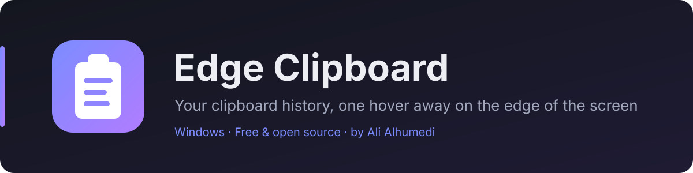
</p>

<p align="center">
  <a href="https://github.com/alimwork85-web/hafaclip/releases/latest"></a>
  
  <a href="LICENSE"></a>
  <a href="https://github.com/alimwork85-web/hafaclip/releases"></a>
  
  
</p>

<p align="center"><a href="#english">English</a> · <a href="#arabic">العربية</a></p>

<a id="english"></a>

<h1 align="center">HafaClip <sub><sup>(Edge Clipboard)</sup></sub></h1>

**HafaClip** (حافة, Arabic for *edge*; previously named Edge Clipboard) is a free, open-source clipboard manager for Windows. It hides as a thin line on the edge of your screen; move the mouse there (or press <kbd>Ctrl</kbd>+<kbd>Alt</kbd>+<kbd>E</kbd>) and your clipboard history slides out. Everything stays on your computer.

<p align="center">
  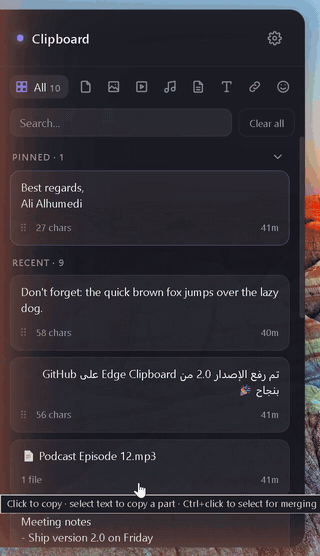
</p>

## Features


Hover the handle to open, move away to close. Left or right edge, your choice.


<kbd>Ctrl</kbd>+<kbd>Alt</kbd>+<kbd>E</kbd> (or your own shortcut) opens the panel with the cursor in search; type to filter, <kbd>↑</kbd> <kbd>↓</kbd> to move between cards, <kbd>Enter</kbd> to paste, <kbd>Alt</kbd>+<kbd>1</kbd>…<kbd>9</kbd> to paste a numbered card, <kbd>Esc</kbd> to close.


Text, images and files (every file of a multi-file copy). Each kind can be turned off.


Copies that KeePass, Bitwarden, 1Password and others mark as sensitive are never saved.


**New in 3.1.** Pick programs (your bank, a work app…) whose copies are never captured.


**New in 3.1.** New images are read on your PC by the OCR built into Windows (Arabic and English), so searching "invoice" finds a screenshot of one. The text is used only for search.


All, Files, Images, Videos, Audio, Docs, Text, Links and Emoji, each with its count.


Keep 250, 500, 750 or 1000 items, optionally auto-delete after 30 or 40 days. **Pinned items are kept forever.**


Paste straight into the app you were using, or just copy with a click.


Western digits (٠١٢ → 012) or without Arabic diacritics, without changing the saved item.


Turn `hgsghl ugd;l` into «السلام عليكم» (and back) with one click.

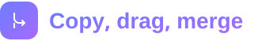

Copy part of a text, drag and drop in and out, merge several items into one (drag a card onto another, or <kbd>Ctrl</kbd>+click) and split them back.


**New in 3.2.** Give a group a name (it is found by search), paste the whole group or just one part of it, and take a part back out. A group left with one part becomes a single item again.


Categories, recent emoji and search in English or Arabic.


Follows Windows, or pick one, with right-to-left layout and Arabic-aware search that ignores diacritics, hamza forms and ة/ه.


5 themes (Light, Dark, Ocean, Forest and Sand), 4 fonts (including Cairo, Tajawal and IBM Plex Sans Arabic), text size, density, panel width, open delay, and the handle's length, thickness and colour, with an optional second colour at its top and bottom.


Can be turned off from the tray icon, and capturing can be paused on demand.

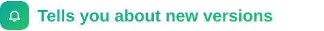

**New in 3.1.** A small notice with a download link; nothing is downloaded or installed by itself.


**New in 3.1.** Settings → Data folder → Open, then copy that folder.

## Screenshots

| History | Settings | Light mode |
|:---:|:---:|:---:|
| 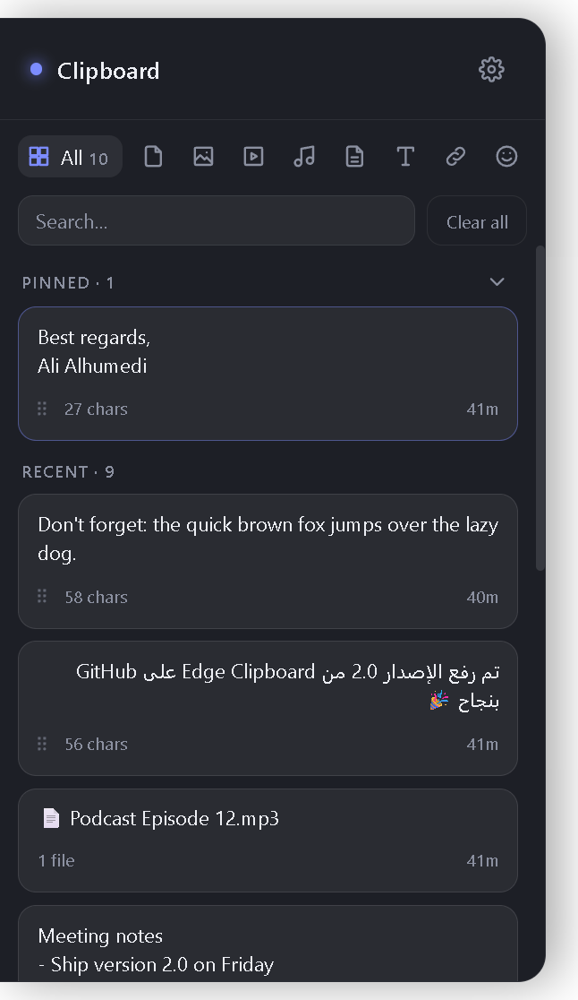 | 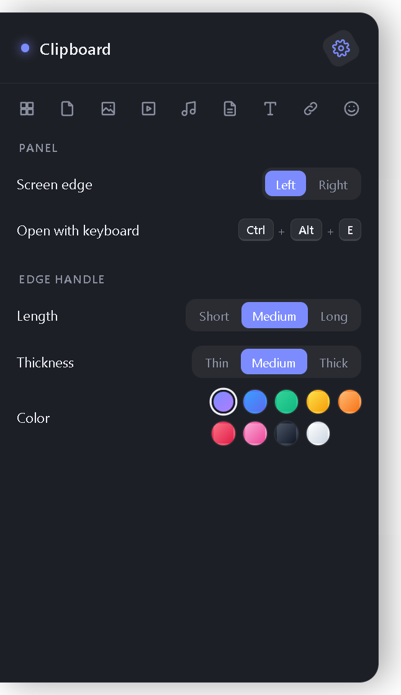 | 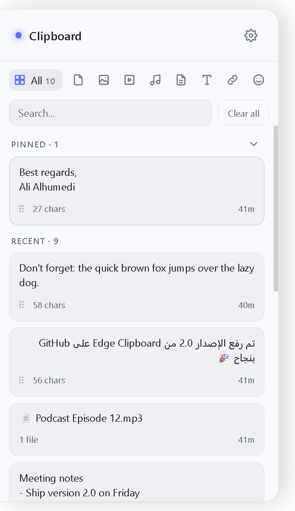 |

| Images | Files | Emoji |
|:---:|:---:|:---:|
| 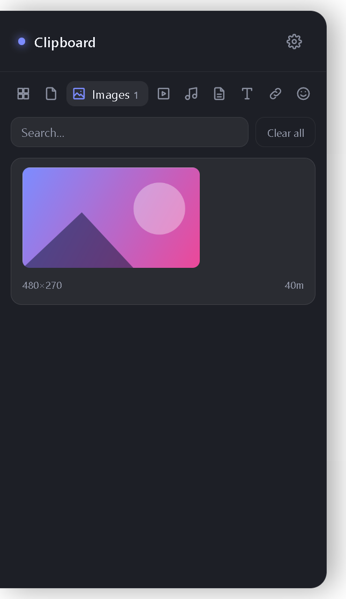 | 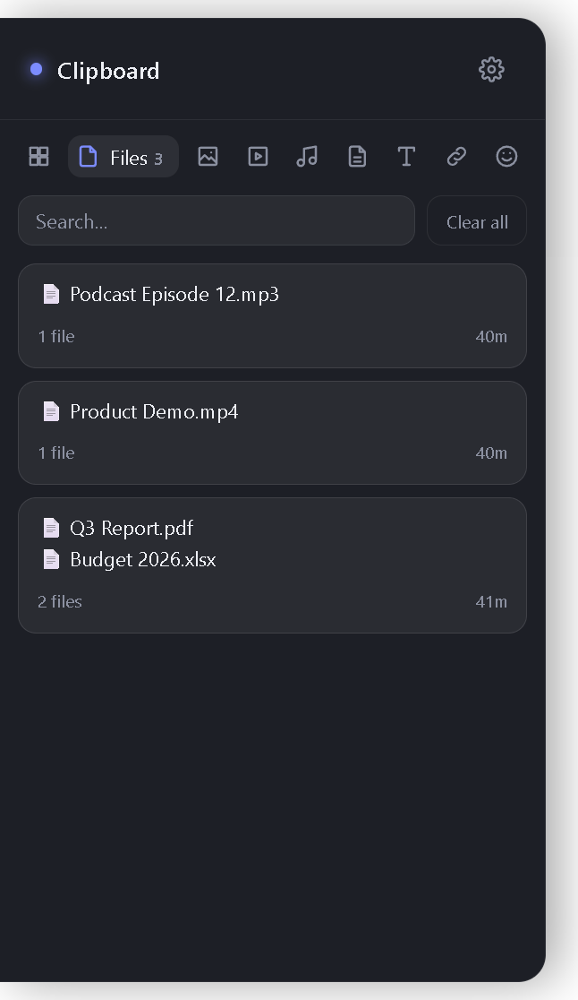 | 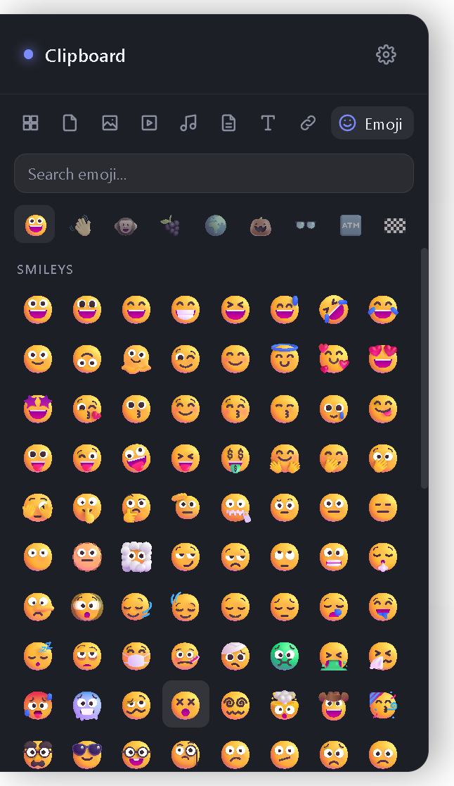 |

## Install

1. Download **`HafaClip Setup x.y.z.exe`** from the [latest release](https://github.com/alimwork85-web/hafaclip/releases/latest).
2. Run it. It installs for your user only (no admin rights) and adds **HafaClip** to the Start menu. Installing it over Edge Clipboard keeps your history and settings.
3. The handle appears on the left edge of the screen; the app also starts with Windows from now on.

> The installer is not code-signed, so Windows SmartScreen may warn the first time. Choose **More info → Run anyway**.

## How to use

| Action | How |
|---|---|
| Open the panel | Hover the handle on the screen edge, or press <kbd>Ctrl</kbd>+<kbd>Alt</kbd>+<kbd>E</kbd> |
| Copy an item | Click its card |
| Paste into the previous app | <kbd>Enter</kbd> on a card, <kbd>Alt</kbd>+<kbd>1</kbd>…<kbd>9</kbd>, or hover a card → ↩ button |
| Paste with Western digits / without diacritics | Hover a text card → ⋯ button |
| Fix text typed in the wrong keyboard language | Hover a text card → ⇄ button (adds the fixed text as a new item) |
| Copy part of a text | Select the words → **Copy selection** (or <kbd>Ctrl</kbd>+<kbd>C</kbd>) |
| Pin / unpin | Hover a card → 📌 button |
| Merge items | Drag a card onto another card, or <kbd>Ctrl</kbd>+click cards → **Merge** |
| Name a group | Hover the group → ✎ button, type, <kbd>Enter</kbd> |
| Paste or take out one part of a group | Hover the part → ↩ (paste) or ↗ (take out) |
| Drag a text card out | Drag the ⠿ grip in its corner |
| Find an image by its text | Type a word that appears in it in the search box |
| Stop capturing from a program | ⚙ → **Don't capture from** → click the program |
| Back up the history | ⚙ → **Data folder** → **Open**, copy the folder (to restore: quit HafaClip, put it back) |
| Settings | ⚙ button in the panel header |
| Pause capturing, quit | Right- or left-click the tray icon |

## Smaller download

Version 3.0.0 ships only the English and Arabic language files of Chromium and compresses harder:

<p align="center">
  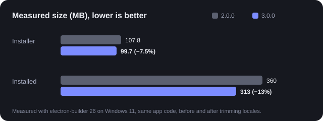
</p>

## Privacy

Your clipboard **never leaves your PC**. History is stored only in `%APPDATA%\edge-clipboard` (`items.json` plus an `images` folder), and the text in images is read locally by Windows. The only network request is a once-a-day check of the latest version number on GitHub, which sends nothing about you or your clipboard and can be turned off in Settings (**Tell me about new versions**). Uninstalling the app does not delete the data folder, so remove it yourself if you want the history gone.

## Feedback and contributing

Feedback is very welcome, and so is help:

- **Found a bug or something confusing?** [Open an issue](https://github.com/alimwork85-web/hafaclip/issues/new) with what you did, what you expected and what happened (a screenshot helps).
- **Have an idea or a suggestion?** Open an issue and describe it; small or big, all ideas are read.
- **Want to help build it?** Pull requests are welcome: fixes, features, translations to more languages, docs or design. For anything large, open an issue first so we can agree on the approach.
- **Like it?** A ⭐ on the repo and sharing it with friends helps others find it.

Messages in English or Arabic are both fine.

## Build from source

Requires [Node.js](https://nodejs.org) 22 or newer.

```bash
git clone https://github.com/alimwork85-web/hafaclip.git
cd hafaclip
npm install
node node_modules/electron/install.js   # downloads Electron if npm skipped install scripts
npm test
npm start          # run the app
npm run dist       # build the Windows installer into dist/
```

Built with [Electron](https://www.electronjs.org), [React](https://react.dev), [electron-vite](https://electron-vite.org), [koffi](https://koffi.dev) for Win32 clipboard calls, [emojibase-data](https://emojibase.dev) for emoji, [Unicode CLDR](https://cldr.unicode.org) for Arabic emoji names, and the [Cairo](https://github.com/Gue3bara/Cairo), [Tajawal](https://fonts.google.com/specimen/Tajawal) and [IBM Plex Sans Arabic](https://github.com/IBM/plex) fonts (SIL Open Font License).

---

<a id="arabic"></a>

<div dir="rtl">

<h1 align="center">حافة · HafaClip <sub><sup>(Edge Clipboard)</sup></sub></h1>

**حافة (HafaClip)**، واسمه السابق Edge Clipboard، مدير حافظة مجاني ومفتوح المصدر لنظام Windows. يختبئ كخط رفيع على حافة الشاشة؛ حرّك الفأرة إليه (أو اضغط <kbd>Ctrl</kbd>+<kbd>Alt</kbd>+<kbd>E</kbd>) فينزلق لك سجل كل ما نسخته. كل شيء يبقى على جهازك.

### المزايا


مرّر الفأرة على المقبض ليفتح، وابتعد ليُغلق. الحافة اليسرى أو اليمنى، حسب اختيارك.


<kbd>Ctrl</kbd>+<kbd>Alt</kbd>+<kbd>E</kbd> (أو اختصارك الخاص) يفتح اللوحة والمؤشر في البحث؛ اكتب للتصفية، و<kbd>↑</kbd> <kbd>↓</kbd> للتنقّل بين البطاقات، و<kbd>Enter</kbd> للصق، و<kbd>Alt</kbd>+<kbd>1</kbd>…<kbd>9</kbd> للصق البطاقة المرقّمة، و<kbd>Esc</kbd> للإغلاق.


النصوص والصور والملفات (كل ملف عند نسخ عدة ملفات). ويمكن إيقاف أي نوع منها.


ما ينسخه KeePass وBitwarden و1Password وغيرها ويُعلَّم كسرّي لا يُحفظ أبدًا.


**جديد في 3.1.** اختر برامج (تطبيق البنك، برنامج عمل…) لا يُلتقط شيء مما تنسخه منها.


**جديد في 3.1.** تُقرأ الصور الجديدة على جهازك بمحرك OCR المدمج في Windows (العربية والإنجليزية)، فتجد لقطة الشاشة بالبحث عن كلمة فيها. النص يُستعمل للبحث فقط.


الكل، الملفات، الصور، الفيديو، الصوت، المستندات، النصوص، الروابط، الإيموجي، ولكل منها عدده.


احتفظ بـ 250 أو 500 أو 750 أو 1000 عنصر، مع حذف تلقائي اختياري بعد 30 أو 40 يومًا. **العناصر المثبّتة تبقى دائمًا.**


الصق مباشرة في البرنامج الذي كنت تعمل فيه، أو انسخ بنقرة.


بأرقام غربية (٠١٢ ← 012) أو بدون تشكيل، دون تغيير العنصر المحفوظ.

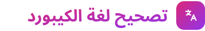

حوّل `hgsghl ugd;l` إلى «السلام عليكم» (والعكس) بنقرة.


انسخ جزءًا من النص، واسحب وأفلت من اللوحة وإليها، وادمج عدة عناصر في عنصر واحد (اسحب بطاقة إلى بطاقة أخرى، أو Ctrl+نقرة) ثم افصلها.

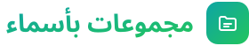

**جديد في 3.2.** سمِّ المجموعة باسم تجده بالبحث، والصق المجموعة كاملة أو جزءًا واحدًا منها، وأخرج أي جزء منها. والمجموعة التي يبقى فيها جزء واحد تعود عنصرًا عاديًا.


فئات وأحدث المستخدم، وبحث بالعربية أو الإنجليزية.


تتبع لغة Windows أو تختار بنفسك، باتجاه من اليمين لليسار، وبحث يفهم العربية فيتجاهل التشكيل وأشكال الهمزة والفرق بين ة وه.


5 سمات (فاتح، داكن، محيط، غابة، رملي)، و4 خطوط (منها القاهرة وتجوال وIBM Plex Sans Arabic)، وحجم النص، والكثافة، وعرض اللوحة، ومهلة الفتح، وطول المقبض وسماكته ولونه، مع لون ثانٍ اختياري لأعلاه وأسفله.


يمكن إيقاف ذلك من أيقونة شريط المهام، ويمكن إيقاف الالتقاط مؤقتًا.

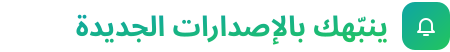

**جديد في 3.1.** سطر صغير فيه رابط التنزيل، ولا يُنزَّل أو يُثبَّت شيء من تلقاء نفسه.


**جديد في 3.1.** الإعدادات ← مجلد البيانات ← فتح، ثم انسخ المجلد. وللاستعادة: أغلق حافة وأعد المجلد مكانه.

### التثبيت

1. نزّل **`HafaClip Setup x.y.z.exe`** من [آخر إصدار](https://github.com/alimwork85-web/hafaclip/releases/latest).
2. شغّله. يُثبَّت لحسابك فقط (بلا صلاحيات مدير) ويضيف **HafaClip** إلى قائمة ابدأ. تثبيته فوق Edge Clipboard يحافظ على سجلك وإعداداتك.
3. يظهر المقبض على الحافة اليسرى من الشاشة، ويعمل التطبيق مع بدء Windows من الآن.

> المثبّت غير موقّع رقميًا، لذلك قد يحذّرك Windows SmartScreen في المرة الأولى. اختر **مزيد من المعلومات ← التشغيل على أي حال**.

### الخصوصية

ما تنسخه **لا يغادر جهازك أبدًا**. يُحفظ السجل على جهازك فقط في `%APPDATA%\edge-clipboard`، ونص الصور يقرؤه Windows محليًا. الاتصال الوحيد بالإنترنت فحص يومي لرقم آخر إصدار على GitHub، لا يرسل شيئًا عنك أو عن حافظتك، ويمكن إيقافه من الإعدادات (**تنبيه بالإصدارات الجديدة**). إلغاء التثبيت لا يحذف مجلد البيانات، فاحذفه بنفسك إن أردت مسح السجل.

### ملاحظاتك ومشاركتك مرحّب بها

يسعدني سماع رأيك، ويسعدني أكثر أن تشاركني:

- **وجدت مشكلة أو شيئًا غير واضح؟** [افتح بلاغًا (Issue)](https://github.com/alimwork85-web/hafaclip/issues/new) واذكر ما فعلت، وما توقعت، وما حدث (صورة الشاشة تساعد كثيرًا).
- **عندك فكرة أو اقتراح؟** افتح بلاغًا واشرحه؛ كل فكرة تُقرأ، صغيرة كانت أو كبيرة.
- **تريد المساعدة في التطوير؟** طلبات الدمج (Pull requests) مرحّب بها: إصلاحات، أو مزايا، أو ترجمة لغات أخرى، أو توثيق، أو تصميم. وللتغييرات الكبيرة افتح بلاغًا أولًا لنتفق على الطريقة.
- **أعجبك؟** نجمة ⭐ للمستودع ومشاركته مع أصدقائك تساعد غيرك على الوصول إليه.

يمكنك الكتابة بالعربية أو الإنجليزية.

### المطوّر والناشر

**Ali Alhumedi**

</div>

## Developer and publisher

**Ali Alhumedi** · [@alimwork85-web](https://github.com/alimwork85-web)

## License

[MIT](LICENSE) © 2026 **Ali Alhumedi**
